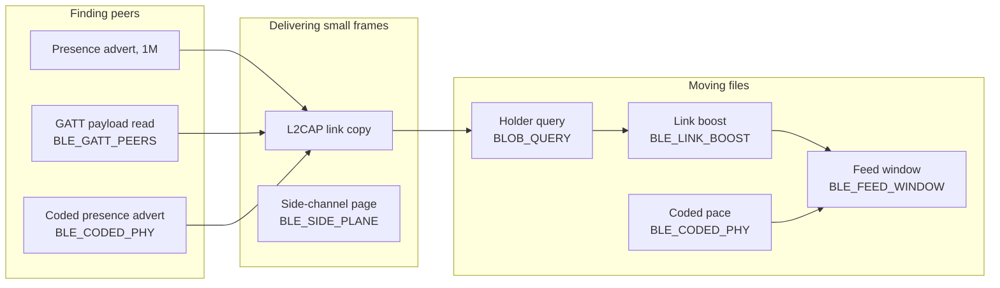
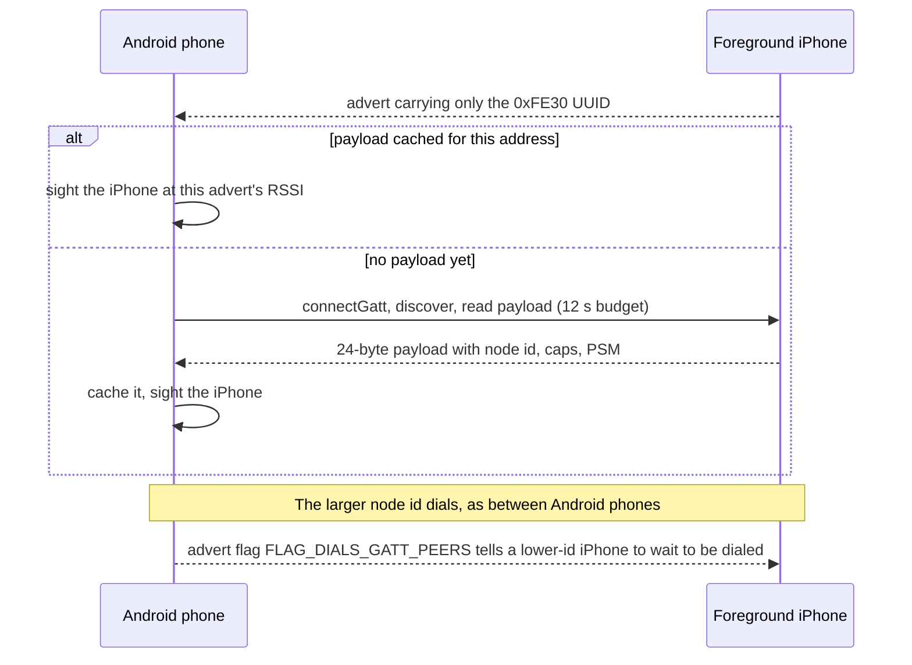
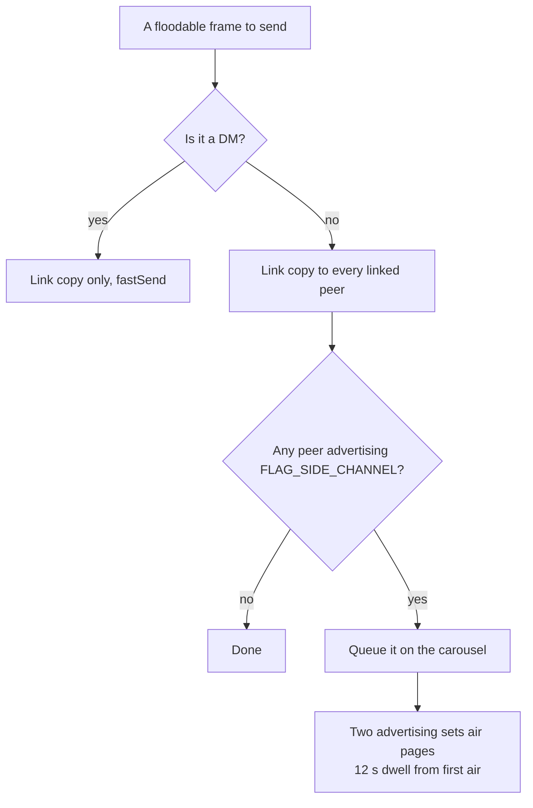
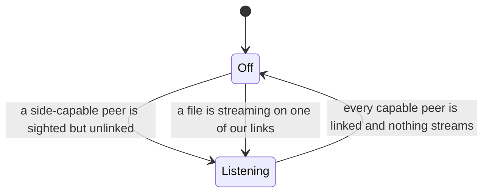
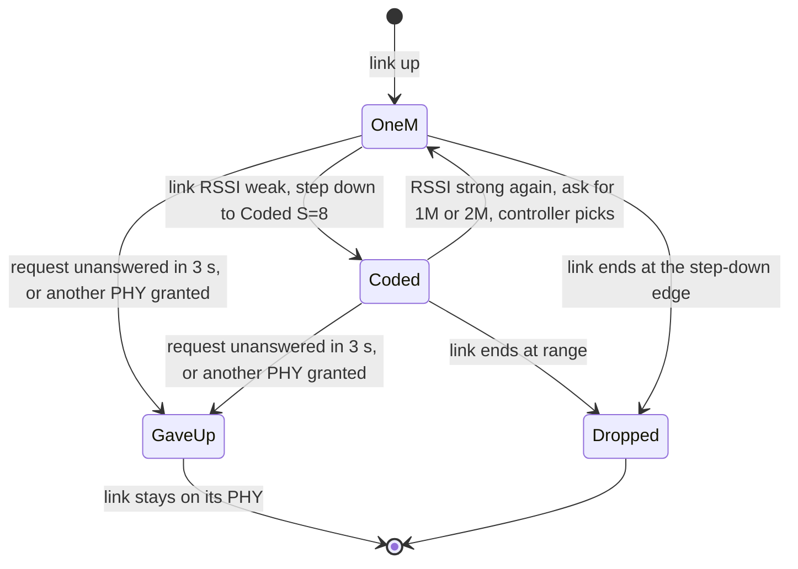
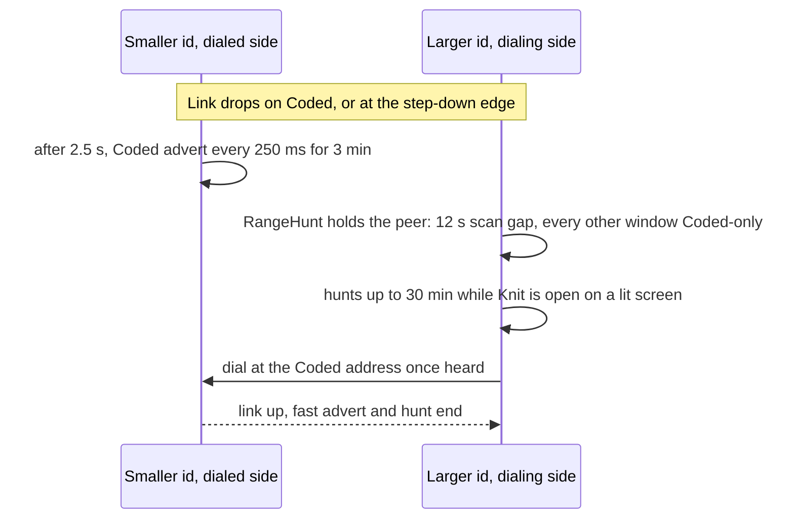
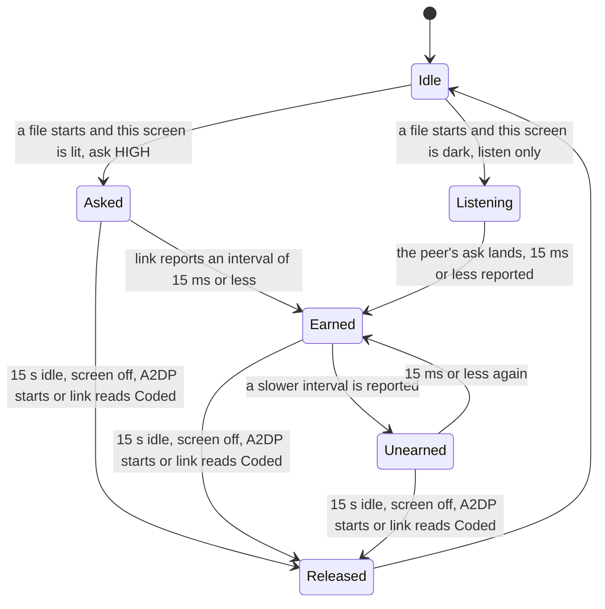
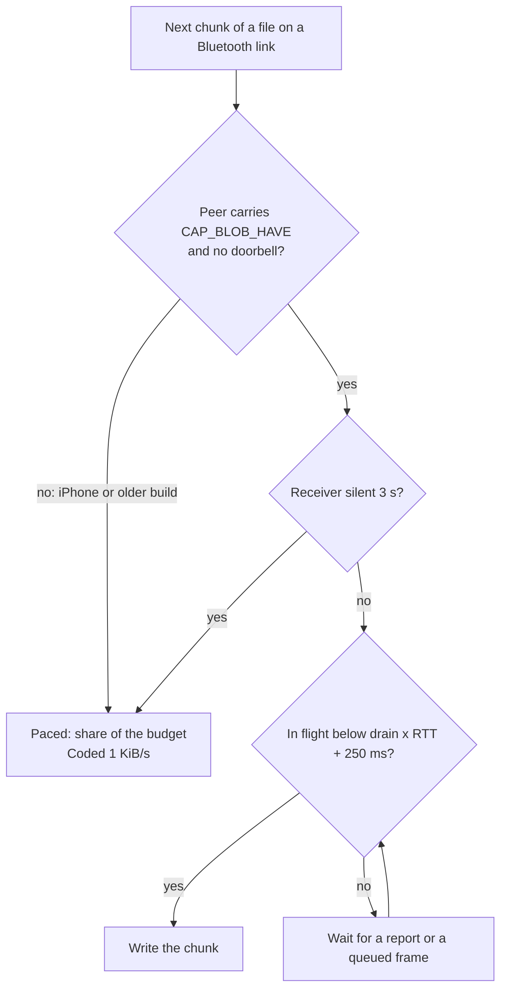
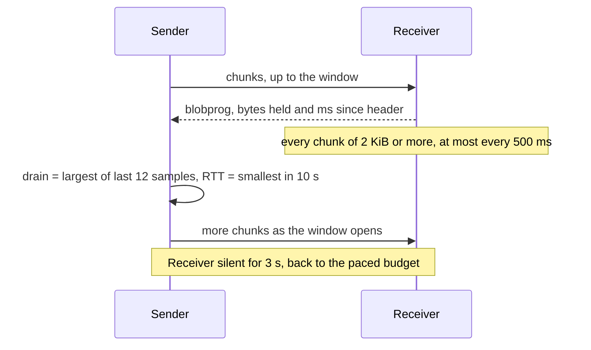

# What the Bluetooth plane does since 2026-10-08

**Status:** describes `main` at `713b29d6` (2026-10-08), the commit that turned the Bluetooth features below on in
release builds. Before it they ran on debug builds only. The decisions behind them:

| Feature | Build flag | ADR |
|---|---|---|
| Android phones find and dial iPhones | `BLE_GATT_PEERS` | 2026-09.kwq2 |
| Room traffic rides advertising pages beside the links | `BLE_SIDE_PLANE` | 2026-09.sjaa, 2026-09.u8qj |
| Links reach farther on the Coded PHY | `BLE_CODED_PHY` | 2026-10.yvn6 |
| A link feeding a file asks for a shorter interval | `BLE_LINK_BOOST` | 2026-10.2da4 |
| A file is clocked by its receiver's reports | `BLE_FEED_WINDOW` | 2026-10.5buf |
| A phone asks which neighbour holds a blob first | `BLOB_QUERY` | 2026-10.6e5t |

Each flag defaults to on in debug and release, and `-P<flag>=false` builds that feature dark (`app/build.gradle.kts`).
The defaults live in source, so F-Droid's rebuild, which passes no `-P`, gets the same flags. This page explains how
the features behave together. The ADRs hold the evidence and the rejected options, and
[`PICTURE_FETCH_BLUETOOTH.md`](PICTURE_FETCH_BLUETOOTH.md) covers the picture fetch in depth.

## Where each feature acts

Bluetooth carries three kinds of work: finding peers, delivering small frames, and moving files. Each feature
improves one of them.

## Android phones find iPhones (`BLE_GATT_PEERS`)

An Android phone now sights a foreground iPhone and links to it. iOS cannot put service data in an advert, so a
foreground iPhone advertises only the `0xFE30` UUID. It serves the same 24-byte payload an Android advert carries from
a GATT characteristic instead (`DoorbellPolicy.PAYLOAD_UUID`).

The presence scan matches that UUID as a second filter. A UUID-only advert sights the iPhone from a cached payload for
its address, or starts a read of the payload. `GattPayloads` paces the reads the same way the iOS port does: one at a
time, 12 s each, 30 s after a failure and 10 min after a stranger. It also keeps at most 64 addresses, because an
iPhone's address rotates.

A cached payload is forgotten when a dial to the address fails before its channel opens, when a HELLO on that link
names another node, or after 60 s of scanning without hearing it while no link is up. The dial rule is unchanged: the
larger id dials. A backgrounded iPhone cannot be sighted this way.

## Room traffic reaches unlinked phones (`BLE_SIDE_PLANE`)

Nearby-room posts, reactions, receipts, group updates and profiles now reach a phone that can hear this one but holds
no link to it. They also stay prompt while a file streams on a link. These frames ride **advertising pages**:
non-connectable extended adverts under their own service UUID (`0xFE38`), which the controller schedules apart from
the links. A page carries one `FastFrameCodec` unit of at most 236 B. A direct message never rides a page, because a
page is a broadcast.

Sending keeps the link copy and adds the page, so a linked peer gets the frame as before.

`SideCarousel` rotates its queue (32 frames, 30 s freshness) through two advertising sets. Each page dwells 12 s from
first air, one screen-off scan interval. Frames with fewer parts go first, a started frame finishes first, and typing
cues coalesce per sender.

Listening costs battery, so `SideScanPolicy` runs the page scan only while a page could carry something the links
will not.

A phone sets `FLAG_SIDE_CHANNEL` in its presence advert's flags byte only after its controller passes the
extended-advertising probe. A phone without extended advertising keeps using its links alone.

**Known gap, #143.** Around every connection the Bluetooth stack pauses and resumes all advertising sets in one
command, and a refused resume reports nothing. The presence advert re-asserts itself after each connection (ADR
2026-10.9utz). The two page sets retry only a failed start, so after a silent refusal they can stay off the air until
the next bring-up.

## Links reach farther on the Coded PHY (`BLE_CODED_PHY`)

Two phones now find each other and stay linked from farther apart, on controllers that support the LE Coded PHY (S=8,
"long range"). Coded spends speed to gain distance: a link on it carries files at about 1 KiB/s, so the plane steps a
link down only when the signal calls for it.

**Finding.** A second presence set airs the same payload on Coded, and the presence scan listens on every PHY. While
the phone has no link, or an unlinked peer is heard only on Coded, every other scan window is Coded-only. A Coded
sighting is scored at +12 dB on the 1M scale (`CodedPhyPolicy.effectiveRssi`), so every −90 dBm floor means what it
did before. The legacy 1M advert stays for scanners that cannot hear extended adverts, iPhones among them.

**Dialing.** A peer heard on Coded alone for more than 8 s of 1M listening is dialed at its Coded address, with a 25 s
watchdog instead of 12 s. While Coded runs, a dialer heard on Coded alone is admitted whatever the id order, so a far
pair does not wait on each other.

**Stepping.** The larger id reads the link's RSSI through a GATT client on the same connection (`BlePhyControl`) and
asks `PhyStepper` whether to step.

**Recovering a link lost at range.** When a link with a PHY handle drops at range, both sides work to get it back for
3 minutes.

**Control.** A release build always runs the AUTO mode. The Diagnostics row that pins Off, Auto, Coded or 1M, and
`…debug.PHY`, are debug-only walk-test tools; a release build ignores any mode a debug install left stored.
Diagnostics shows each link's PHY as a chip in every build. iPhones have no Coded PHY, and a phone whose controller
lacks it (the Pixel 3) runs the legacy plane.

## Files move faster on a lit screen (`BLE_LINK_BOOST`)

While either phone's screen is on, a photo between them can feed at 18 KiB/s instead of the 4 KiB/s base. A
Bluetooth link drains the host's share of the controller's buffers once per connection event, so its speed follows
the connection interval: about 9 KB/s at 45 ms, 22.5–29 KB/s at 15 ms. On 2026-10-06 a 410 KB photo between two lit
Pixels took 23.8 s.

While a file moves either way, a side whose screen is on asks for `CONNECTION_PRIORITY_HIGH` (and a larger ATT MTU
once) through a GATT client on the link. A dark side only listens, so a sender in a pocket still earns the interval a
watching receiver asked for. A link earns the larger budget only when the controller *reports* an interval of 15 ms or
less.

An earned link feeds at 18 KiB/s, or 12 KiB/s once the phone holds more than four LE connections; every other link
feeds at the 4 KiB/s base, split among the links feeding at once. A peer that reports its progress gets the feed
window below instead of these budgets, and the boost's shorter interval raises the drain that window follows. An
iPhone link is never boosted, because its doorbell owns the link parameters (ADR 2026-09.dqvb).

## A file is clocked by its receiver (`BLE_FEED_WINDOW`)

A file now moves as fast as its link drains, and a chat message sent mid-photo waits behind only a short queue. The
Bluetooth stack holds hundreds of KB before a write blocks, so the sender cannot see the drain from its own side.
Instead the receiver reports what it holds (`blobprog`), and the sender keeps about one round trip plus 250 ms of
data queued ahead of it.

The window holds from two of the link's smallest chunks (2 KiB on 1M/2M, 1 KiB on Coded) to 64 KiB. A PHY step
forgets the round trip, and a step to or from Coded forgets the drain too, so the window probes again. Every build
since `blobprog` reports progress, so the window turns on in the same release as the reports.

## A phone asks which neighbour holds a picture (`BLOB_QUERY`)

A picture now comes from the neighbour best placed to send it rather than the first one that seemed likely. Before it
asks for a blob, a phone sends `blobhave` to each neighbour whose link carries `CAP_BLOB_HAVE` and asks the best
holder by plane and load. The asking is what the flag gates. Every build answers a query, so a mixed fleet keeps
working, and neighbours that cannot answer (the iOS port, older builds) get ADR 2026-10.f7gg's round of asks.
[`PICTURE_FETCH_BLUETOOTH.md`](PICTURE_FETCH_BLUETOOTH.md) walks through the choice, the parked asks and the bounds.

## Trials still owed

The flags turned on ahead of these device trials, which the roadmap tracks:

- a battery night on a settled clique, all flags on against all off;
- a walk-apart under Off, Auto and Coded, measuring link-drop distance;
- the iPhone gate in both id orders, measuring first-link time;
- the feed window and link boost cells: a text behind a photo, a dark receiver, a mixed v2.8.0 fleet, fan-out, more
  than four LE links, the Moto G;
- the holder query with two holders on different links;
- a minified `staging` build feeding a photo to a debug phone, since none of this code had run under R8 before;
- advertising-set churn across eight link cycles on the Pixel 7, the Moto G and the Pixel 3 (#143).

## Where it lives

| Piece | Code |
|---|---|
| GATT payload reads | `BleGattPayloadReader`, `GattPayloads`, `BleScanner` (second filter), `BluetoothMeshTransport.onScanResult` |
| Side channel | `BleSideChannel`, `SideCarousel`, `SideScanPolicy`, `SideCapableTracker`, `BleFastRoutePolicy` |
| Coded PHY | `CodedPhyPolicy`, `PhyStepper`, `BlePhyControl`, `CodedAdvertPace`, `RangeHunt`, `BlePresenceTracker` |
| Link boost | `BleLinkBoost`, `LinkBoostPolicy`, `BleLinkTuner`, `LinkParamsCallback` |
| Feed window | `FeedWindow`, `RxReports`, `FramedLink.feedChunks`, `BluetoothMeshTransport.paceFor` |
| Holder query | `BlobExchange.want` / `onHaveQuery` / `onHaveAnswer` / `decide` |
| Flags | `app/build.gradle.kts`, the `BleSideChannel?` and mode flow `di/MeshModule.kt` hands the transport |
| Tests | `GattPayloadsTest`, `SideChannelLabTest`, `CodedPhyPolicyTest`, `BleFeedPolicyTest`, `BlobHaveLabTest` |
